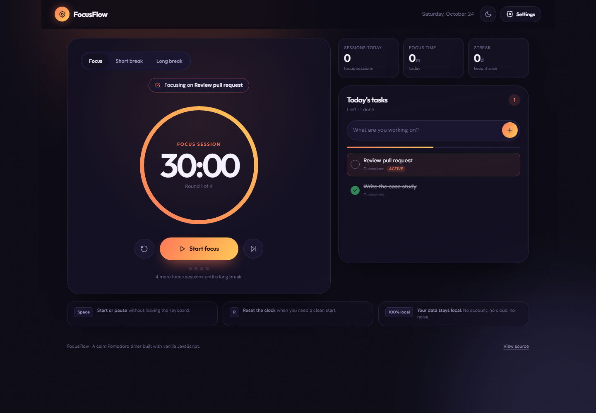

# FocusFlow — Pomodoro Timer & Task List

FocusFlow is a calm, single-page Pomodoro timer that helps you start, stay with one task, and finish. It pairs a focus/break cycle with a lightweight task list, daily stats, streaks, keyboard shortcuts, and settings — all saved locally in your browser.

**Live app:** https://sphinxss.github.io/focusflow/



## Features

- **Pomodoro timer** — focus, short break, and long break modes with a gradient progress ring.
- **Custom cycles** — set session lengths and how many focus sessions trigger a long break.
- **Task list** — add tasks, mark them done, delete them, and choose the one you're focusing on. Completed sessions are counted against the active task.
- **Daily stats** — sessions completed, total focus minutes, and a day streak.
- **Auto-start options** — optionally roll straight into breaks and back into focus.
- **Sound + notifications** — a soft Web Audio chime and optional desktop alerts.
- **Keyboard shortcuts** — `Space` starts/pauses, `R` resets.
- **Dark & light themes** — remembered between visits.
- **Installable PWA** — works offline after the first load.
- **Local-first** — no accounts, no server, no tracking.

## Tech stack

Vanilla HTML, CSS, and JavaScript. No frameworks or build tools. The circular timer is an SVG progress ring; state is persisted in `localStorage`; sound is synthesized with the Web Audio API; offline support comes from a service worker.

## Run locally

```bash
python -m http.server 8080
```

Then open <http://localhost:8080>.

## How the timer works

1. Add a task and select it (the first task you add becomes active automatically).
2. Press **Start focus**. The ring counts down from your configured focus length.
3. When focus ends, FocusFlow logs the session, adds a pomodoro to the active task, and moves to a short break. Every *N* focus sessions gives you a long break.
4. Use **Pause**, **Reset**, or **Skip** at any time. Skipping a focus session does not count it.
5. Open **Settings** to change durations, cycle length, auto-start behavior, sound, and notifications.

## Data & privacy

Everything is stored in your browser's `localStorage` under `focusflow-v1`. Nothing is uploaded. Clearing site data removes your tasks, sessions, and settings.

## Project structure

```
focusflow/
├── index.html          # App shell and markup
├── styles.css          # Theme, layout, timer ring, tasks, responsive styles
├── app.js              # Timer engine, tasks, stats, settings, persistence
├── manifest.webmanifest
├── sw.js               # Offline app-shell cache
└── icons/
```

## Accessibility

- The timer exposes a live textual state and the ring is decorative.
- Native `<dialog>` is used for settings with focus management.
- Tasks are reachable by keyboard, with visible focus states and labelled controls.
- Reduced-motion preferences are respected.

## Author

Built by **Joshua Barrera** — [github.com/sphinxss](https://github.com/sphinxss)
